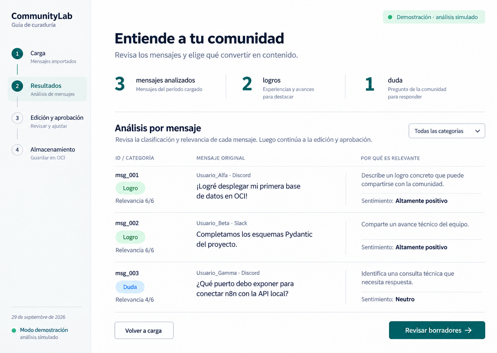
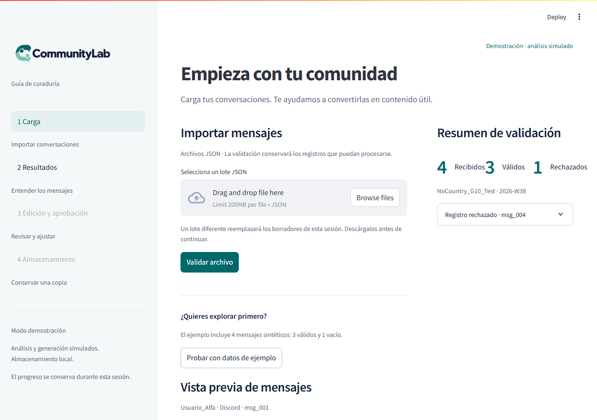
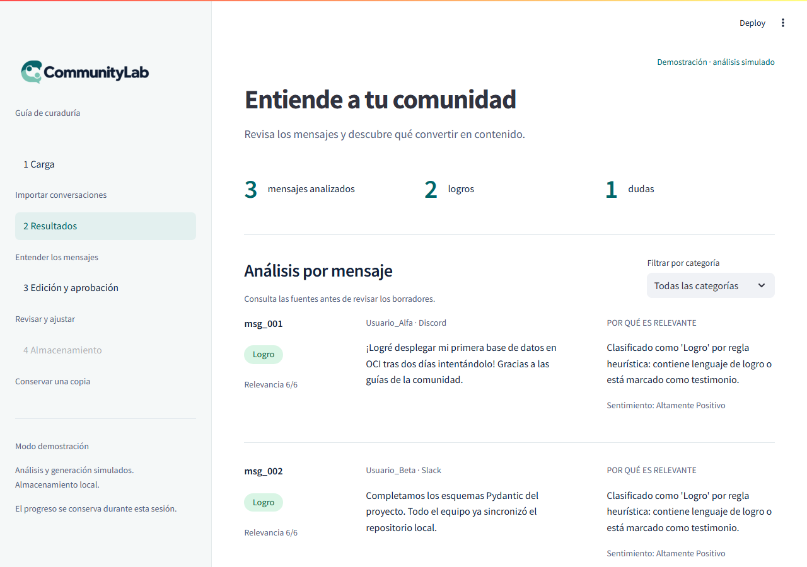
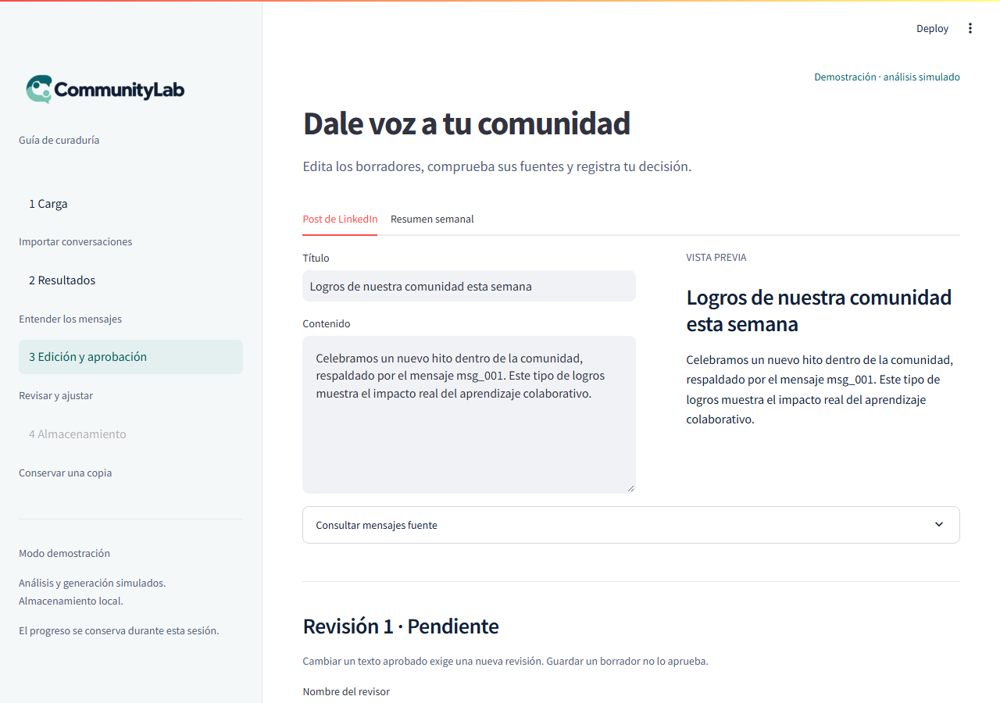
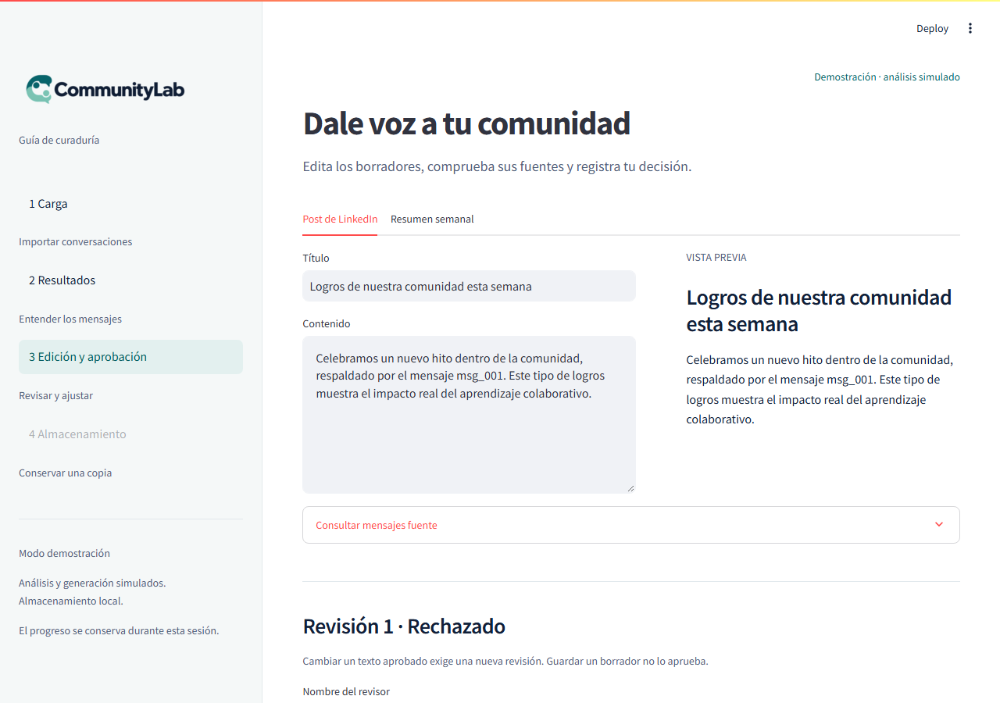
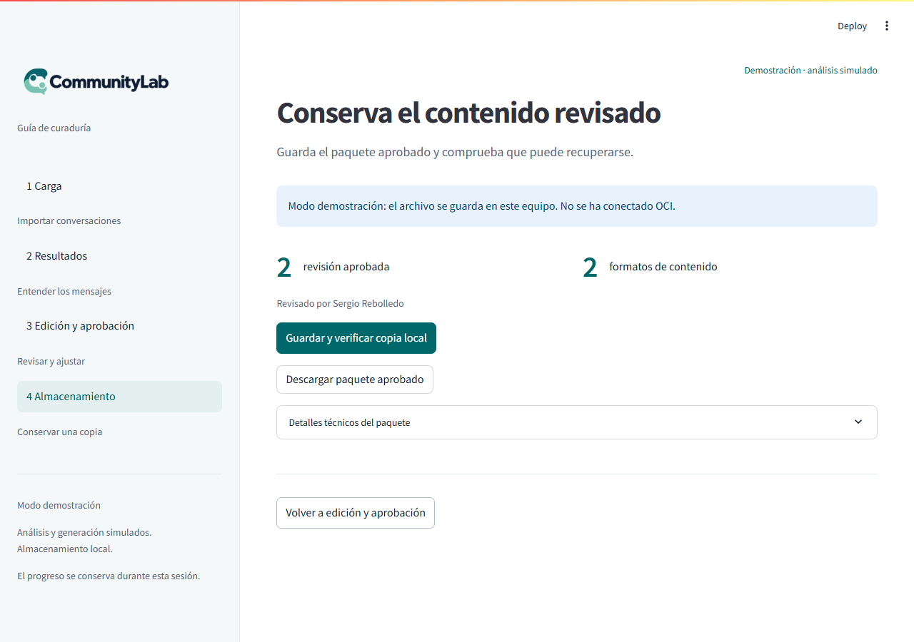
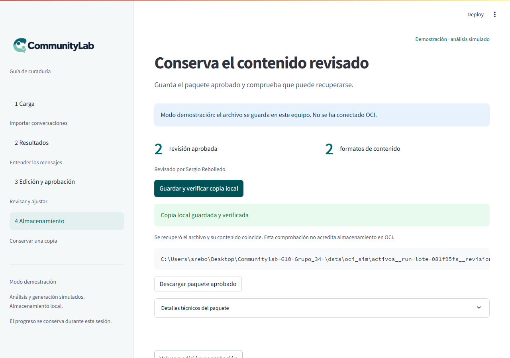

# Panel de curaduría: diseño e implementación

**Responsable:** Sergio Rebolledo · Frontend. **Actualización:** 14 de octubre de 2026.

Documento de entrega del módulo: diseño, herramientas, estructura, pantallas,
conexiones, ejecución, pruebas y pendientes.

**Lectura rápida según la tarea:**

- Para demostrar el panel: [pantallas](#funcionamiento-de-las-cuatro-pantallas) y [guion de demo](#guion-de-demo-para-el-equipo).
- Para ejecutarlo: [instrucciones](#instrucciones-de-ejecución) y [problemas frecuentes](#problemas-frecuentes).
- Para integrarlo: [conexiones](#conexiones-y-responsabilidades) y [acuerdos de integración](#acuerdos-a-cerrar-antes-de-conectar-el-panel).
- Para revisarlo: [pruebas](#pruebas-y-evidencias) y [criterios de aceptación](#pendientes-y-criterios-de-aceptación).

## Estado y seguimiento

- [Issue #8: revisión humana](https://github.com/No-Country-simulation/Communitylab-G10-Grupo_34-/issues/8): cerrada; panel inicial integrado mediante el [PR #13](https://github.com/No-Country-simulation/Communitylab-G10-Grupo_34-/pull/13).
- [PR #17](https://github.com/No-Country-simulation/Communitylab-G10-Grupo_34-/pull/17): abierto al corte. Corrige el import del validador y añade una prueba de arranque.
- [PR #18](https://github.com/No-Country-simulation/Communitylab-G10-Grupo_34-/pull/18): abierto al corte. Incluye #17 y mejora mensajes y estados; revisar #17 primero.
- [Issue #10: E2E](https://github.com/No-Country-simulation/Communitylab-G10-Grupo_34-/issues/10): pendiente de integración real.
- [Issue #11: documentación y evidencias](https://github.com/No-Country-simulation/Communitylab-G10-Grupo_34-/issues/11): esta entrega documenta el frontend, sin cerrar la entrega conjunta.

Se revisó `main` en `52be6dd` y se probó el panel corregido en `2425ba2`, rama
`feat/ui-estados-mensajes`. Los cambios de los PR abiertos no se consideran
integrados en `main`. Este documento no cambia comportamiento del programa.

## Diseño

El panel ayuda a revisar conversaciones, consultar su análisis, editar contenido
y registrar una decisión humana antes de conservar el paquete. Aprobar no
publica en LinkedIn.

La variante aprobada usa fondo claro, acento verde petróleo, navegación lateral
en cuatro pasos y mensajes originales junto al análisis. Las categorías tienen
etiquetas además del color. El CSS define foco visible en botones y ajustes por
debajo de 800 px; no se afirma una auditoría completa de accesibilidad.



El logo está en [ui/assets/communitylab-logo.png](../ui/assets/communitylab-logo.png).
Los estilos se separan en [ui/styles.css](../ui/styles.css). La identidad visual
puede reutilizarse si cambia el framework, pero los componentes Streamlit
requerirían una nueva implementación.

## Herramientas y librerías

- **Python 3.11.x:** versión actual exigida por `pyproject.toml`; prevalece sobre el acuerdo inicial de 3.12.
- **uv y `uv.lock`:** entorno reproducible con `uv sync --frozen`.
- **Streamlit (`>=1.63,<1.64`):** controles, pantallas, callbacks, descargas y `st.session_state`.
- **Pydantic:** validación y serialización con los contratos de `esquemas.py`; versión resuelta en `uv.lock`.
- **pytest y `streamlit.testing.v1.AppTest`:** verificación automatizada del recorrido sin navegador ni credenciales cloud.
- **CSS:** presentación adaptable; este módulo no usa React ni compilación de JavaScript.
- **Biblioteca estándar:** JSON, SHA-256, fechas UTC, rutas, escape HTML y UUID en el simulador.
- **Git/GitHub:** ramas en fork y PR sujetos a revisión.

FastAPI, LangGraph, structlog y el SDK OCI son dependencias del proyecto. Su
presencia no implica que el panel esté conectado a la API, el grafo o la nube.

## Estructura

```text
ui/app.py                     Pantallas, navegación y estado de sesión
ui/styles.css                 Estilos y ajustes de tamaño
ui/mock_pipeline.py           Análisis y borradores de demostración
ui/storage_demo.py            Copia local, lectura y comparación
ui/assets/communitylab-logo.png
ui/README.md                  Entrada a la documentación
tests/test_frontend.py         Pruebas del panel y copia local
docs/screenshots/             Diseño y capturas históricas
```

`main()` despacha a `carga()`, `resultados()`, `edicion()` o `almacenamiento()`.
`load_batch()` admite el lote; `invalidate()` retira la decisión y evidencia
anterior cuando corresponde. `heading()`, `stats()` y `footer()` unifican la
presentación. Los datos y las reglas de contrato provienen de otros módulos.

## Funcionamiento de las cuatro pantallas

Las seis capturas siguientes provienen de la implementación ya versionada en
`docs/screenshots/`. Se incluyen como guía visual del recorrido, no como prueba
nueva de los textos del PR #18 ni de integración con SQLite/OCI.

### Carga

Admite JSON canónico `IngestionLote` o el ejemplo `data/raw/lote_prueba_01.json`.
Pydantic valida el sobre y `validar_lote_crudo()` separa registros válidos y
rechazados. Muestra conteos, motivos y mensajes. El ejemplo produce **4
recibidos / 3 válidos / 1 rechazado**. Sin válidos no habilita el análisis.

SHA-256 detecta el mismo archivo y conserva el progreso; un lote distinto
reemplaza el trabajo en sesión. Una carga inválida conserva el lote anterior.
La UI actual no llama a `adaptar_payload_oficial()`: admitir el JSON plano del
jurado mediante el flujo oficial sigue pendiente.



**Qué revisar:** el rechazo de `msg_004` no bloquea los otros tres mensajes.
La vista previa permite comprobar autor, canal y texto antes del análisis.

### Resultados

`analizar_mock()` clasifica mediante reglas locales, no un LLM. Presenta conteos,
categoría, relevancia, sentimiento, motivo y fuente, con filtro Logro/Duda/
Dificultad. Los conteos se calculan desde la sesión; todavía no proceden de SQLite.



**Qué revisar:** el identificador de cada resultado debe corresponder al mensaje
fuente. El ejemplo muestra 3 analizados, 2 logros y 1 duda; otros lotes pueden
producir distribuciones diferentes.

### Edición y aprobación

`generar_copys_mock()` prepara post de LinkedIn y resumen semanal si el
simulador encuentra mensajes aptos. Las pestañas permiten editar, previsualizar
y consultar fuentes. No hay un control de edición de `source_ids`.

Guardar en sesión no aprueba. Aprobar exige textos válidos y nombre del revisor;
rechazar exige además un motivo. Se valida con `ActivosGenerados` y se registra
la fecha UTC de decisión. Editar tras una decisión devuelve el estado a
pendiente, aumenta la revisión y borra paquete/evidencia en memoria. La descarga
del borrador incluye los textos actuales, aunque no se hayan guardado en sesión.



**Qué revisar:** ambas pestañas contienen contenido revisable; la vista previa
no equivale a una publicación. Expandir las fuentes permite contrastar el texto.



**Qué revisar:** rechazar conserva la posibilidad de editar. El estado visible
es la decisión del revisor; no es una valoración de calidad hecha por el sistema.

### Almacenamiento

Requiere aprobación, construye `PaqueteSalida` y permite descargarlo o ejecutar
`storage_demo.guardar_local()`. Escribe en `data/oci_sim/` y compara la lectura
posterior. Reintentar la misma copia es válido; contenido distinto en la misma
ruta produce error.

La copia local verificada **no acredita OCI**. El paquete conserva
`status_almacenamiento = no_iniciado` y `comprobacion_lectura = false`; la
evidencia local se muestra aparte. La pantalla no invoca el cliente OCI real.



**Qué revisar:** una aprobación habilita conservar el paquete, pero todavía no
demuestra que exista un archivo guardado. El número de revisión puede variar
según las decisiones y ediciones realizadas.



**Qué revisar:** la ruta corresponde al equipo que ejecuta Streamlit. En un
servidor compartido no corresponde al equipo de quien abre el navegador;
para llevarse el archivo hay que usar la descarga.

## Estados que no deben confundirse

| Estado o acción | Qué significa | Qué no demuestra |
| --- | --- | --- |
| Registro válido | Cumple las reglas de validación usadas | Que sea apto para publicación |
| Análisis terminado | Hay resultados disponibles en sesión | Que se haya usado un LLM real |
| Borrador guardado en sesión | Los activos se conservan mientras vive la sesión | Persistencia SQLite o descarga |
| Revisión aprobada | Se registró una decisión humana sobre ambos formatos | Publicación en LinkedIn o subida a OCI |
| Copia local verificada | Se escribió y comparó el archivo local | Almacenamiento en la nube |
| OCI `no_iniciado` | No se acredita un guardado OCI en el paquete | Un error de la copia local |
| OCI `guardado_error` | El flujo real informó un problema | Que sea seguro anunciar éxito o lectura verificada |
| OCI `guardado_con_exito` y lectura verdadera | Evidencia esperada del flujo real de guardado y recuperación | Una conexión ya implementada en este panel |

Al integrar OCI, el estado debe pertenecer a la pareja `run_id` +
`numero_revision` seleccionada. Nunca reutilizar la confirmación de una revisión
anterior para un texto que acaba de editarse.

## Sesión y limitaciones

`st.session_state` mantiene paso, lote, válidos/rechazados, análisis, activos,
revisión, paquete, evidencia, huella e identificador de ejecución. Permite
navegar durante la sesión, pero no sustituye un historial persistido. Perder la
sesión puede perder borradores no descargados. El nombre de revisor es un campo
de texto, no una identidad autenticada. No hay publicación automática.

## Conexiones y responsabilidades

- **Contratos:** `esquemas.py` suministra modelos de entrada, activos, revisión y salida. No se modifican en esta entrega.
- **Data Engineering:** #17 importa `data_pipeline.validador.validar_lote_crudo`, que devuelve `InteraccionValidada` y diccionarios de rechazo. Hoy se consumen en memoria.
- **Análisis/generación:** `app.py` importa explícitamente `analizar_mock` y `generar_copys_mock`. Los agentes reales no se activan automáticamente al aparecer sus archivos.
- **Almacenamiento:** la UI llama a `ui.storage_demo.guardar_local`. `storage/oci_client.py` ya existe, pero aún no se conecta al panel.
- **Código histórico:** `mock_pipeline.guardar_paquete()` intenta delegar en OCI, pero `app.py` no lo llama. Ese mecanismo no representa el flujo activo.
- **Orquestación:** no aparece `orchestration/pipeline_runner.py` en el `main` revisado. La interfaz de integración debe coordinarse con Leidalí.

### SQLite disponible en rama de datos

La rama [feat/datos-local-db](https://github.com/No-Country-simulation/Communitylab-G10-Grupo_34-/tree/feat/datos-local-db)
existe al 14 de octubre, en `2491445`, todavía sin PR abierto al corte. Implementa
**`storage/local_db.py`**, no `data_pipeline/db.py`. Usa `SQLITE_DB_PATH` con valor
por defecto `data/communitylab.db`, contiene DDL y `registrar_analisis_bloque()`.

Tablas relevantes para la siguiente integración de Sergio:

- `lotes_procesamiento`: `run_id`, `request_id`, `total_recibidos`, `total_validos`, `total_rechazados` y período.
- `auditoria_rechazados`: `run_id`, `request_id`, `mensaje_id`, `error_detalle` y fecha de aislamiento.
- `evidencia_almacenamiento_oci`: por `run_id` y `numero_revision`, con `status_almacenamiento` y `comprobacion_lectura` (0/1).

El DDL no demuestra que el flujo ya llene las tablas o que la UI las consulte.
Se deben acordar con Andrea las consultas y con Leidalí la persistencia de los
resultados. No se ejecutó la suite de esa rama ni una prueba combinada con los
PR #17/#18 en esta entrega documental.

## Acuerdos a cerrar antes de conectar el panel

Esta lista prepara la coordinación; no define funciones que ya existan ni
sustituye los contratos aprobados por el equipo.

| Coordinación | Información necesaria | Comprobación esperada |
| --- | --- | --- |
| Sergio + Andrea | Consulta de lotes y métricas por `run_id`; origen de la ruta SQLite | Reabrir la sesión y recuperar los mismos totales |
| Sergio + Andrea | Consulta de rechazos por ejecución y significado de sus campos | Mostrar motivo y mensaje sin mezclar lotes |
| Sergio + Leidalí | Entrada del flujo oficial, resultado y tratamiento de errores | La UI no duplica admisión, validación ni escritura de auditoría |
| Sergio + responsables de agentes | Activos y análisis tipados, con `source_ids` | Cada referencia permite consultar una fuente del lote |
| Sergio + responsable OCI/orquestación | Evidencia de guardado por ejecución y revisión, política de reintento | El éxito aparece únicamente tras verificación real |
| Sergio + QA | Lotes, resultados esperados y entorno de prueba compartido | Pruebas reproducibles y evidencia asociada al commit |

**Identificadores para diagnóstico:** `request_id` permite correlacionar la
solicitud; `run_id` identifica la ejecución; `source_id`/`source_ids` vinculan
resultados y activos con mensajes; `numero_revision` distingue versiones
revisadas. Conservar los nombres del contrato al serializar.

**Separación prevista:** el backend/adaptador transforma la entrada, valida y
persiste; el panel presenta resultados, recoge la decisión humana y solicita
operaciones a la interfaz acordada. Las consultas SQLite deben parametrizarse
y gestionar conexiones en la capa de acceso, sin mezclar SQL con el renderizado.
Esta separación es un criterio para el siguiente aporte, no el estado actual.

## Instrucciones de ejecución

Requisitos: Git, uv y acceso para instalar las dependencias del lock. Desde la
raíz del repositorio:

```powershell
uv sync --frozen
uv run --frozen streamlit run ui/app.py
```

Abrir la dirección mostrada por Streamlit (normalmente `http://localhost:8501`).
Detener con `Ctrl+C`. No se requiere activar `.venv` manualmente con `uv run`.
La demostración no necesita claves de Gemini ni credenciales OCI.

Mientras los PR estén abiertos, reproducir el panel corregido en un clon limpio:

```powershell
git clone --branch feat/ui-estados-mensajes https://github.com/sergiorebolledo/Communitylab-G10-Grupo_34-.git communitylab-panel
cd communitylab-panel
uv sync --frozen
uv run --frozen streamlit run ui/app.py
```

Si en el `main` del corte aparece `No module named 'validador'`, utilizar la
rama corregida o integrar #17. No crear otra copia del validador en la raíz.

## Guion de demo para el equipo

Duración orientativa: 3 a 5 minutos. Usar datos sintéticos y la rama corregida
indicada arriba. Descargar cualquier trabajo previo antes de cargar otro lote.

| Paso | Acción en pantalla | Qué explicar o comprobar |
| --- | --- | --- |
| 1 | Probar con datos de ejemplo | Se aíslan los defectuosos: 4 recibidos, 3 válidos, 1 rechazado |
| 2 | Continuar al análisis y analizar demostración | Clasificación local; mostrar una fuente y su justificación |
| 3 | Revisar y preparar borradores | Dos formatos, editor, vista previa y fuentes |
| 4 | Aprobar sin nombre | El sistema exige identificar al revisor |
| 5 | Completar revisor y aprobar | La decisión habilita almacenamiento; no publica contenido |
| 6 | Guardar y verificar copia local | Confirmación local y distinción explícita respecto de OCI |
| 7 | Descargar paquete aprobado | Entregable JSON disponible para inspección |
| 8 | Volver a edición y modificar contenido | Se pierde la aprobación previa y se necesita otra revisión |

Para el recorrido alternativo de rechazo, escribir nombre y motivo, rechazar
y comprobar que almacenamiento no se habilita. No presentar esta demo local
como evidencia del E2E real.

## Problemas frecuentes

| Síntoma | Revisión y siguiente acción |
| --- | --- |
| `uv` no se reconoce | Instalar/configurar uv según [SETUP](SETUP.md); abrir otra terminal y comprobar `uv --version` |
| Versión de Python incompatible | Usar `uv sync --frozen` con el `pyproject.toml` actual; no cambiar el requisito de Python para ocultar el error |
| `No module named 'validador'` | Comprobar rama/commit; aplicar #17, sin duplicar el módulo |
| No aparece la interfaz | Ejecutar desde la raíz y abrir la URL que imprime Streamlit; revisar el error de la terminal |
| Puerto ocupado | Ejecutar `uv run --frozen streamlit run ui/app.py --server.port 8502` y abrir la URL indicada |
| JSON rechazado antes de mostrar conteos | Revisar el sobre contra `IngestionLote`; la carga actual aún no adapta el JSON plano oficial |
| No se generan borradores | En el simulador debe haber mensajes aptos; probar el ejemplo y revisar las categorías |
| No permite aprobar/rechazar | Revisar ambos formatos, nombre y, para rechazo, motivo; los errores aparecen en la pantalla |
| No se guarda la copia local | Revisar permisos/espacio y posible colisión de revisión; descargar el paquete aprobado antes de investigar |
| Se perdió el progreso tras reiniciar | La sesión actual no es historial persistido; recuperar descargas. La recuperación desde SQLite es pendiente |

El comando vigente del panel es `streamlit run ui/app.py`; si una guía anterior
señala `app/streamlit_app.py`, usar el punto de entrada de este documento.

## Cómo reportar un problema y reunir evidencia

Registrar en la issue correspondiente los siguientes datos, sin claves ni
conversaciones privadas:

```text
Rama y commit:
Sistema operativo y versión de Python:
Comando utilizado:
Lote sintético utilizado:
Pantalla y pasos para reproducir:
Resultado esperado:
Resultado observado:
request_id / run_id / revisión (si existen):
Captura y error de terminal relevante:
```

Para #10 conservar evidencia del recorrido integrado. Para #11 reunir el
documento, capturas y salida de pruebas con fecha y commit. Nombrar nuevas
capturas, por ejemplo, `AAAA-MM-DD-carga-COMMIT.png`, indicando si muestran
demostración o integración real. Una captura aislada no sustituye la prueba
de persistencia o recuperación en OCI.

## Pruebas y evidencias

Repetidas el **14 de octubre de 2026** sobre `2425ba2`, antes de crear esta rama
documental, con el entorno Python 3.11 del proyecto y dependencias del lock:

```powershell
uv run --frozen pytest -q
# 26 passed, 1 deselected in 4.58s
```

La prueba excluida está marcada `integration` y requiere OCI real; no cuenta
como aprobada. Esta evidencia no certifica SQLite ni agentes reales.

`tests/test_frontend.py` comprueba arranque, conteos 4/3/1, revisor obligatorio,
aprobación, invalidación al editar, conservación del mismo lote e idempotencia/
colisión local. Para ejecutarlo: `uv run --frozen pytest tests/test_frontend.py -q`.

Las [capturas existentes](screenshots/) son evidencia histórica de diseño y
recorrido; no son capturas nuevas de #18. No se realizó una nueva revisión
visual en esta entrega. Las notas de evidencia de #17 y #18 están en sus PR.

Recorrido manual propuesto para Andrea:

1. Cargar el ejemplo y comprobar 4/3/1 y el motivo del rechazo.
2. Analizar y cotejar resultados con sus mensajes fuente.
3. Preparar ambos borradores e intentar aprobar sin nombre: debe mostrar error.
4. Rechazar con nombre/motivo, editar y registrar nueva aprobación.
5. Guardar copia local y comprobar que ningún aviso acredita OCI.
6. Volver a editar y comprobar que se exige una nueva revisión.

## Pendientes y criterios de aceptación

1. **Andrea:** revisar #17/#18 con su rama de datos y registrar ajustes antes de integrarlos.
2. **Sergio/SQLite:** consultar historial, métricas y rechazos persistidos; deben seguir disponibles tras reiniciar la sesión. Evitar duplicar reglas de ingesta en la UI.
3. **Ingesta oficial:** consumir adaptador y validación/persistencia acordados; probar JSON plano del jurado y aislamiento de registros corruptos.
4. **Orquestación/agentes:** reemplazar demostración por llamadas oficiales, preservando `source_ids` y trazabilidad por ejecución.
5. **Sergio/OCI:** mostrar la evidencia real de la revisión seleccionada. Solo indicar guardado verificado con éxito y lectura comprobada; un error debe permitir recuperación sin perder el borrador aprobado.
6. **E2E y evidencia:** ejecutar los lotes oficiales Logro, Duda y Dificultad y reunir capturas/logs sin secretos para #10/#11.
7. **Revisión visual:** comprobar mensajes, navegación por teclado y ancho móvil tras integrar los cambios.

Esta entrega completa la documentación del panel existente. La conexión real
SQLite/OCI sigue pendiente y no se da por realizada en #17 o #18.
